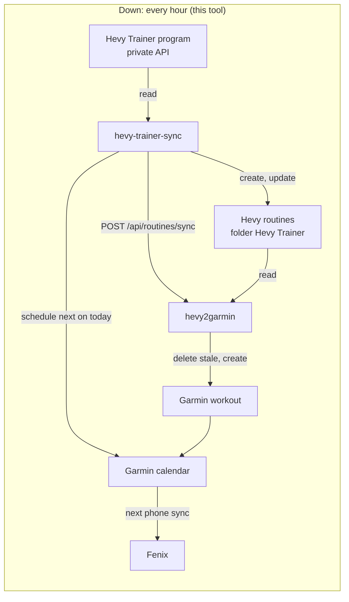
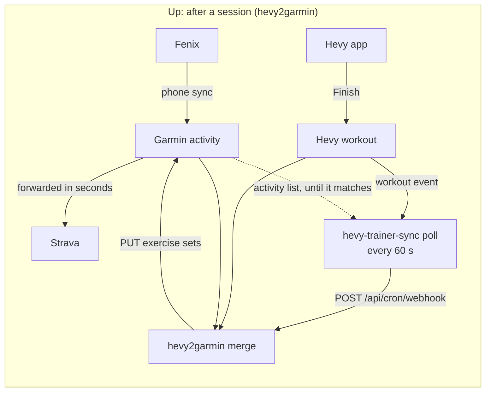

# Architecture

hevy-trainer-sync is one Python package with two modes. The default mode runs to completion and exits: it reads Hevy Trainer's program, writes Hevy routines, and drives two systems that already exist, the hevy2garmin dashboard and Garmin Connect. The `poll` mode runs forever, watches Hevy for saved workouts, and tells hevy2garmin to merge each one once Garmin has the watch's activity for it. It owns no database and serves nothing. Everything it knows between runs is one file: the Hevy session on a persistent volume, which only the default mode uses.

## The two flows

Two flows run in opposite directions through the same services. This tool is the first flow. The second belongs to hevy2garmin, and this tool only depends on it.

Garmin forwards the watch's activity to Strava before the merge can run, and Strava never takes anything after that first post. The merge fixes Garmin Connect only. What Strava shows is what the watch recorded, which is why the planned workout this tool builds has to be right. Record: [0020](architectural-decision-records/0020-the-watch-recording-is-what-strava-keeps.md). The poller gets the merge into Garmin Connect on the first poll after the watch syncs, and because it asks only once the watch's activity is there, hevy2garmin never uploads an activity of its own. Record: [0039](architectural-decision-records/0039-merge-only-after-the-watch-activity.md).

## The poller

`python -m hevy_trainer_sync poll` (`poll.main()`) builds one `poll.Poller` and calls `tick()` every `POLL_SECONDS`:

1. `hevy_public.Client.workout_events()` reads every event since the high-water mark, which starts 48 hours (`poll.GIVE_UP`) before the process did, so a restart forgets nothing it was waiting on.
2. `poll.new_workouts()` keeps the `updated` events whose `updated_at` is after the mark. Each one joins `Poller.waiting`, and the mark moves past it. If any was saved after the poller started and `RUN_CRONJOB` is set, `kube.run_cronjob()` creates one Job from that CronJob, so the mirror updates the routines and the calendar at once. Record: [0041](architectural-decision-records/0041-run-the-mirror-after-each-save.md).
3. `Poller.settle()` drops the waiting workouts that `db.synced_ids()` says hevy2garmin has finished, and gives up, with a warning, on any that ended more than 48 hours ago. Those stay in Hevy only.
4. It takes the newest waiting workout and nothing else. hevy2garmin's webhook route takes no workout id and syncs the newest workout it has not finished, so asking while a newer one waits would sync that one instead.
5. It reads the dashboard's `merge_settings` (`db.merge_settings()`, parsed by `match.settings()`). If merge is off or the watch strategy is not `merge`, it logs an error and asks nothing, because hevy2garmin would upload.
6. `garmin.Garmin.activities()` lists Garmin's activities from a day before the workout to a day after, with hevy2garmin's token. A 401 has the dashboard refresh it, as in Send to Device.
7. `match.find()`, a port of hevy2garmin's `findMergeMatch`, looks for the watch's recording. Only when it finds one does `h2g.trigger_merge()` post to `POST /api/cron/webhook` with `CRON_SECRET`. hevy2garmin's first attempt then finds the same activity and merges. A workout it was asked about is asked again 30 minutes later (`poll.ASK_AGAIN`) if it is still not finished.

Any failed call, Hevy, Garmin, the database or the dashboard, with an HTTP error or no answer at all, is logged and tried again on the next poll. Waiting workouts live in memory.

It needs the public API key, the cron secret, the database and the dashboard password. It never reads or refreshes the Hevy session, so it cannot break the mirror's token chain. Record: [0039](architectural-decision-records/0039-merge-only-after-the-watch-activity.md).

## One run

`cli.main()` does these in order. Each step logs one line, and any failure exits non-zero.

0. **Lock.** `state.locked()` holds an exclusive lock on `HEVY_STATE_FILE.lock` for the whole run, so a run the poller started and an hourly one never touch the session together. Record: [0041](architectural-decision-records/0041-run-the-mirror-after-each-save.md).
1. **Session.** `state.load_or_bootstrap()` reads `HEVY_STATE_FILE`, or on the first run parses `HEVY_SESSION` and saves it at once. `hevy_private.Session` refreshes the access token when Hevy answers 401 and rewrites the file through its `persist` callback. Record: [0006](architectural-decision-records/0006-session-on-a-volume.md).
2. **Program.** `Session.get_program()` calls `GET /hevy_trainer/v3/program`. Templates are sorted by `index`, and `next_workout_index` names the next one.
3. **Weights.** `hevy_public.Client.recent_workouts()` reads the last `WORKOUT_PAGES` pages of workouts, and `build.last_weights()` keeps the last working-set weight per exercise, the fallback for an exercise Trainer prescribes nothing for.
3a. **Trainer's prescriptions.** `cli.trainer_plan()` reads the user's preferences (username, unit, first weekday), Trainer's preferences (the weights the user has) and, with `Session.workouts_since()`, every workout since the program started, each tagged with its Trainer template. `trainer_rules.calendar_week()` gives the week, cycle and week of cycle, and `build.plan()` gives each exercise's working weight, warm-ups or rep range by the app's rules, using `library.py` for its type and equipment. The log lists each one. Record: [0042](architectural-decision-records/0042-trainer-prescriptions-by-the-apps-rules.md).
4. **Folder.** The folder titled `FOLDER_TITLE` is found or created.
5. **Routines.** For each template, `build.routine_from_template()` builds the payload, with Trainer's prescriptions, named by `build.title()` for the cycle and week (`Upper C2 W2`). An existing routine is matched by base title with `build.is_titled_from()`, compared with `build.normalize()`, and created, updated or left alone. Record: [0042](architectural-decision-records/0042-trainer-prescriptions-by-the-apps-rules.md).
6. **Dashboard.** `h2g.Dashboard` logs in with `H2G_PASSWORD` and posts the changed routine ids (all of them with `--force`) to `POST /api/routines/sync`.
7. **Send to Device.** Only with `SEND_TO_DEVICE=1`, which the cluster no longer sets. With `DATABASE_URL` set, `db.garmin_workouts()` and `db.garmin_di_token()` read hevy2garmin's tables, and `garmin.Garmin.send_workout()` queues each new workout for the watch. Records: [0009](architectural-decision-records/0009-send-to-device-from-here.md), [0040](architectural-decision-records/0040-the-calendar-carries-workouts-to-the-watch.md).
8. **Calendar.** With `SCHEDULE_NEXT=1`, which the cluster sets. Runs every hour, changed or not. `schedule.plan()` keeps one entry, the next workout on today in `TZ`, and has the dashboard unschedule every other entry of the managed routines and schedule today's if it's missing. Garmin carries the calendar to the watch. Record: [0040](architectural-decision-records/0040-the-calendar-carries-workouts-to-the-watch.md).

`--dry-run` stops after step 5 without writing anything. The session is still refreshed, because reading the program needs a valid token.

## Modules

| Module | Does | I/O |
|---|---|---|
| `cli.py` | The run above, and dispatch of `poll` | Orchestrates the rest |
| `poll.py` | The poller loop, the event filter, the waiting workouts | Hevy public API, hevy2garmin, its Postgres, Garmin Connect |
| `match.py` | hevy2garmin's merge settings and its rules for matching a workout to a watch activity | None |
| `state.py` | Bootstrap from the cookie, atomic save with mode 0600, the run lock | The state file |
| `kube.py` | One Job from a CronJob, as the pod's service account | Kubernetes API |
| `hevy_private.py` | Session refresh, the Trainer program, both preferences, the user's workouts | Hevy private API |
| `hevy_public.py` | Folders, routines, recent workouts | Hevy public API |
| `h2g.py` | Dashboard login, routine sync, schedule and unschedule, and `trigger_merge` | hevy2garmin HTTP |
| `db.py` | Read-only queries; `psycopg` is imported lazily | hevy2garmin Postgres |
| `garmin.py` | Last-used device, the device message and the activity list | Garmin Connect |
| `build.py` | Template to payload, names, each exercise's prescription, comparison | None |
| `trainer_rules.py` | Trainer's rules for the week, weights, rep ranges and warm-ups, as the app runs them | None |
| `library.py` | The app's built-in exercise library, read from app 3.2.5 | None |
| `schedule.py` | The calendar plan | None |
| `http.py` | One `urllib` wrapper and `HttpError` | Every HTTP call |

There are no third-party HTTP clients. The image installs `psycopg[binary]` and `tzdata` and nothing else.

## Deployment

It runs in TJ's cluster next to hevy2garmin, in namespace `hevy2garmin-system`, from [Kubernetes-Manifests](https://github.com/zimmertr/kubernetes-manifests) `misc/hevy2garmin`. Argo CD application `hevy2garmin` syncs it.

| Object | What |
|---|---|
| CronJob `hevy-trainer-sync` | `7 * * * *`, `concurrencyPolicy: Forbid`, `backoffLimit: 0`, 600 s deadline, UID 1000, read-only root filesystem. Record: [0007](architectural-decision-records/0007-hourly-cronjob.md) |
| Deployment `hevy-trainer-poll` | One replica, `Recreate`, args `poll`, same image, no volume, UID 1000, read-only root filesystem, service account `hevy-trainer-poll` |
| Role `hevy-trainer-poll` | Get CronJob `hevy-trainer-sync`, create Jobs. Record: [0041](architectural-decision-records/0041-run-the-mirror-after-each-save.md) |
| CronJob `hevy2garmin-sync` | hevy2garmin's scheduled sync. Suspended, because it uploads any workout still unsynced two hours after it ends. Record: [0039](architectural-decision-records/0039-merge-only-after-the-watch-activity.md) |
| PVC `hevy-trainer-sync-state` | 1 Gi on `proxmox-flashpool`, mounted at `/state`. Holds `hevy-session.json` and nothing else |
| Secret `hevy2garmin` | Keys `hevy-api-key`, `password`, `cron-secret` (the poller), and `hevy-session` (only needed until the first run) |
| Secret `hevy2garmin-database-app` | Key `uri`, made by CloudNativePG for hevy2garmin's cluster. Both the CronJob and the poller read it |

Both talk to the dashboard through its Service, `http://hevy2garmin`, and to Postgres through the CNPG service in the `uri`. Nothing reaches either from outside.

## Things the design rests on

- **One refresher.** The session file is the only valid copy of a rotating token. Two processes refreshing it would break the chain, so the CronJob forbids overlap and nothing else may run against the same session.
- **hevy2garmin owns Garmin.** This tool never logs in to Garmin and never refreshes Garmin's token. It borrows the token hevy2garmin stores, and asks the dashboard to refresh it on a 401.
- **The routines are a copy.** hevy2garmin keys Garmin workouts on the Hevy routine id, so the routines stay in Hevy. Record: [0014](architectural-decision-records/0014-routines-stay-in-hevy.md).
- **Undocumented endpoints.** Hevy's Trainer endpoint and Garmin's device-message endpoint are both undocumented. See [DATA.md](DATA.md) for what each one returns and the quirks found so far.
