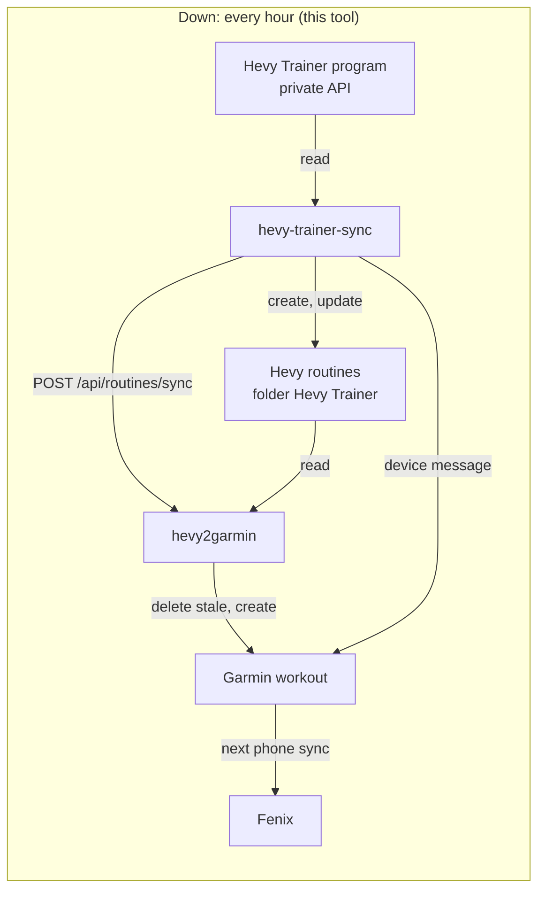
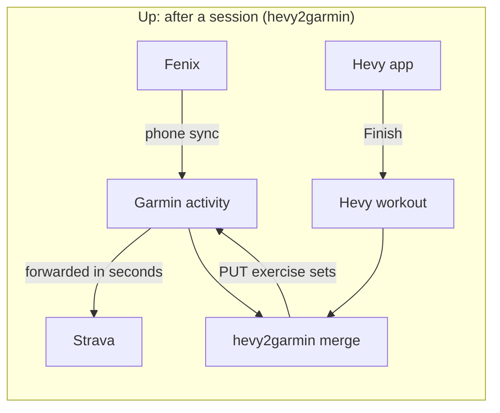

# Architecture

hevy-trainer-sync is one Python command that runs to completion and exits. It owns no database and serves nothing. It reads Hevy Trainer's program, writes Hevy routines, and drives two systems that already exist: the hevy2garmin dashboard and Garmin Connect. Everything it knows between runs is one file: the Hevy session on a persistent volume.

## The two flows

Two flows run in opposite directions through the same services. This tool is the first flow. The second belongs to hevy2garmin, and this tool only depends on it.

Garmin forwards the watch's activity to Strava before the merge can run, so the first Strava post is the watch's version and the merged sets land on it later. [0016](decisions/0016-garmin-keeps-posting-to-strava.md) keeps it that way for now.

## One run

`cli.main()` does these in order. Each step logs one line, and any failure exits non-zero.

1. **Session.** `state.load_or_bootstrap()` reads `HEVY_STATE_FILE`, or on the first run parses `HEVY_SESSION` and saves it at once. `hevy_private.Session` refreshes the access token when Hevy answers 401 and rewrites the file through its `persist` callback. Record: [0006](decisions/0006-session-on-a-volume.md).
2. **Program.** `Session.get_program()` calls `GET /hevy_trainer/v3/program`. Templates are sorted by `index`, and `next_workout_index` names the next one.
3. **Weights.** `hevy_public.Client.recent_workouts()` reads the last `WORKOUT_PAGES` pages of workouts, and `build.last_weights()` keeps the last working-set weight per exercise.
4. **Folder.** The folder titled `FOLDER_TITLE` is found or created.
5. **Routines.** For each template, `build.routine_from_template()` builds the payload, named by `build.title()` for the week from `build.program_week()`. An existing routine is matched by base title with `build.is_titled_from()`, compared with `build.normalize()`, and created, updated or left alone. Record: [0010](decisions/0010-program-week-in-names.md).
6. **Dashboard.** `h2g.Dashboard` logs in with `H2G_PASSWORD` and posts the changed routine ids (all of them with `--force`) to `POST /api/routines/sync`.
7. **Send to Device.** With `DATABASE_URL` set, `db.garmin_workouts()` and `db.garmin_di_token()` read hevy2garmin's tables, and `garmin.Garmin.send_workout()` queues each new workout for the watch. Record: [0009](decisions/0009-send-to-device-from-here.md).
8. **Calendar.** Only with `SCHEDULE_NEXT=1`, which the deployment does not set. `schedule.plan()` decides what to unschedule and whether to schedule today. Record: [0008](decisions/0008-no-calendar-scheduling.md).

`--dry-run` stops after step 5 without writing anything. The session is still refreshed, because reading the program needs a valid token.

## Modules

| Module | Does | I/O |
|---|---|---|
| `cli.py` | The run above | Orchestrates the rest |
| `state.py` | Bootstrap from the cookie, atomic save with mode 0600 | The state file |
| `hevy_private.py` | Session refresh and the Trainer program | Hevy private API |
| `hevy_public.py` | Folders, routines, recent workouts | Hevy public API |
| `h2g.py` | Dashboard login, routine sync, schedule and unschedule | hevy2garmin HTTP |
| `db.py` | Read-only queries; `psycopg` is imported lazily | hevy2garmin Postgres |
| `garmin.py` | Last-used device and the device message | Garmin Connect |
| `build.py` | Template to payload, names, weeks, comparison | None |
| `schedule.py` | The calendar plan | None |
| `http.py` | One `urllib` wrapper and `HttpError` | Every HTTP call |

There are no third-party HTTP clients. The image installs `psycopg[binary]` and `tzdata` and nothing else.

## Deployment

It runs in TJ's cluster next to hevy2garmin, in namespace `hevy2garmin-system`, from [Kubernetes-Manifests](https://github.com/zimmertr/kubernetes-manifests) `misc/hevy2garmin`. Argo CD application `hevy2garmin` syncs it.

| Object | What |
|---|---|
| CronJob `hevy-trainer-sync` | `7 * * * *`, `concurrencyPolicy: Forbid`, `backoffLimit: 0`, 600 s deadline, UID 1000, read-only root filesystem. Record: [0007](decisions/0007-hourly-cronjob.md) |
| PVC `hevy-trainer-sync-state` | 1 Gi on `proxmox-flashpool`, mounted at `/state`. Holds `hevy-session.json` and nothing else |
| Secret `hevy2garmin` | Keys `hevy-api-key`, `password`, and `hevy-session` (only needed until the first run) |
| Secret `hevy2garmin-database-app` | Key `uri`, made by CloudNativePG for hevy2garmin's cluster |

The job talks to the dashboard through its Service, `http://hevy2garmin`, and to Postgres through the CNPG service in the `uri`. Nothing reaches it from outside.

## Things the design rests on

- **One refresher.** The session file is the only valid copy of a rotating token. Two processes refreshing it would break the chain, so the CronJob forbids overlap and nothing else may run against the same session.
- **hevy2garmin owns Garmin.** This tool never logs in to Garmin and never refreshes Garmin's token. It borrows the token hevy2garmin stores, and asks the dashboard to refresh it on a 401.
- **The routines are a copy.** hevy2garmin keys Garmin workouts on the Hevy routine id, so the routines stay in Hevy. Record: [0014](decisions/0014-routines-stay-in-hevy.md).
- **Undocumented endpoints.** Hevy's Trainer endpoint and Garmin's device-message endpoint are both undocumented. See [DATA.md](DATA.md) for what each one returns and the quirks found so far.
