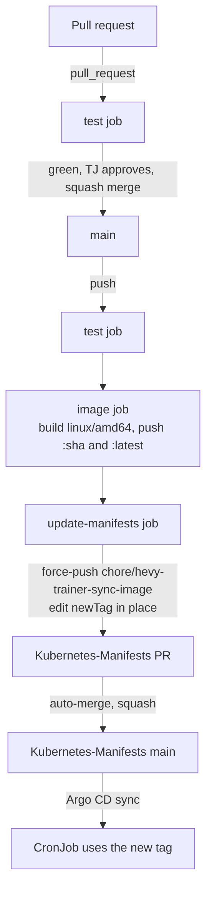

# CI/CD and Deployment Flow

How a change travels from a pull request to the CronJob in the cluster.

> **Keep this current.** A change to `.github/workflows/image.yml`, to the image tag convention, or to how Kubernetes-Manifests wires the job updates this page in the same PR. Changes made in Kubernetes-Manifests that affect this flow come back here too; nothing enforces that.

## Systems

| System | Role |
|---|---|
| GitHub Actions in this repo | Tests every PR, builds and pushes the image on main, opens the Kubernetes-Manifests bump |
| Docker Hub `zimmertr/hevy-trainer-sync` | Image registry. Tags are full commit SHAs, plus `latest` |
| Kubernetes-Manifests `misc/hevy2garmin` | The CronJob, the poller Deployment, the PVC, and the pinned tag in `kustomization.yml`. One `images` entry sets the tag for both |
| Argo CD application `hevy2garmin` (namespace `argo-system`) | Applies Kubernetes-Manifests main to the cluster |

## Flow



1. **test** runs on every PR and every push to main: Python 3.13, `pip install -r requirements-dev.txt`, the unittest suite under `coverage`, and `coverage report`, which fails below 100% of lines and branches. Record: [0018](decisions/0018-full-coverage.md).
2. **image** runs on a push to main after `test`. It builds `linux/amd64` with `docker/build-push-action` and pushes `zimmertr/hevy-trainer-sync:<sha>` and `:latest`, logging in with the `DOCKERHUB_USERNAME` and `DOCKERHUB_TOKEN` secrets. Record: [0005](decisions/0005-images-from-ci-prs-only.md).
3. **update-manifests** runs after `image`. It clones Kubernetes-Manifests with the `GH_PAT` secret, resets `chore/hevy-trainer-sync-image` to that repo's main, changes the one `newTag:` line under `name: zimmertr/hevy-trainer-sync`, force-pushes, opens or retitles the single PR, and arms auto-merge. If the tag is already current it stops. Records: [0011](decisions/0011-ci-bumps-manifests.md), [0012](decisions/0012-tag-edited-in-place.md).
4. **Argo CD** applies the merged manifests. To skip the wait, refresh it:

   ```sh
   kubectl -n argo-system annotate application hevy2garmin argocd.argoproj.io/refresh=normal --overwrite
   ```

5. **The poller** restarts on the new image as soon as Argo CD applies it. **The next scheduled run** of the mirror uses it too. To run the mirror now:

   ```sh
   kubectl -n hevy2garmin-system create job --from=cronjob/hevy-trainer-sync hevy-trainer-sync-manual-$(date +%H%M)
   ```

On 2026-11-05 the path from merge to a merged Kubernetes-Manifests PR took about three minutes.

## What the pipeline does not do

- **Env and secret changes.** The bump touches only the tag. A new variable or secret needs a hand-made Kubernetes-Manifests PR, merged after the image that reads it.
- **Promote between environments.** There is one environment.
- **Roll back.** Revert the commit here and let the pipeline run, or pin the previous SHA by hand in Kubernetes-Manifests.

## Secrets

| Secret | Where | Used by |
|---|---|---|
| `DOCKERHUB_USERNAME`, `DOCKERHUB_TOKEN` | This repo's Actions secrets | `image` |
| `GH_PAT` | This repo's Actions secrets | `update-manifests`. Needs contents and pull-requests write on Kubernetes-Manifests |
