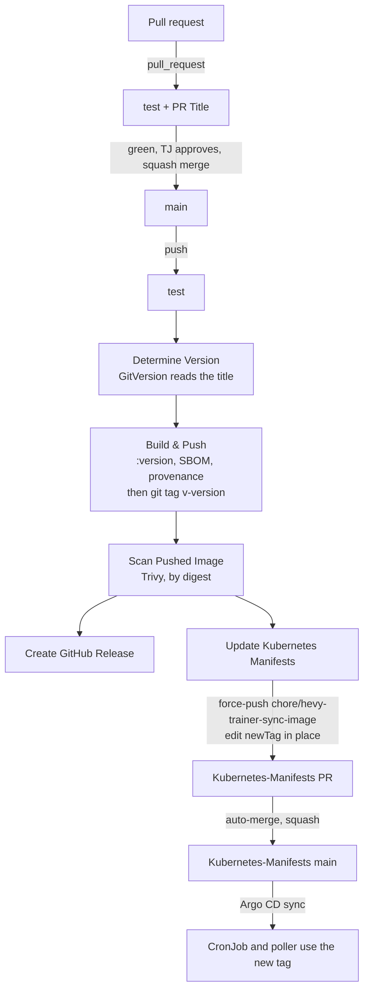

# CI/CD and Deployment Flow

How a change travels from a pull request to the CronJob in the cluster.

> **Keep this current.** A change to anything under `.github/`, to `GitVersion.yml`, to the image tag convention, or to how Kubernetes-Manifests wires the job updates this page in the same PR. Changes made in Kubernetes-Manifests that affect this flow come back here too; nothing enforces that.

## Systems

| System | Role |
|---|---|
| GitHub Actions in this repo | Tests every PR and checks its title. On main, cuts a release and opens the Kubernetes-Manifests bump |
| GitHub releases and tags | One `v<version>` tag and one immutable release per merge, with notes from the PR titles |
| Docker Hub `zimmertr/hevy-trainer-sync` | Image registry. Tags are release versions, such as `0.1.0`. Builds before 0.1.0 are tagged with their commit SHA |
| Kubernetes-Manifests `misc/hevy2garmin` | The CronJob, the poller Deployment, the PVC, and the pinned tag in `kustomization.yml`. One `images` entry sets the tag for both |
| Argo CD application `hevy2garmin` (namespace `argo-system`) | Applies Kubernetes-Manifests main to the cluster |
| Dependabot | Weekly version PRs for pip, Actions and the base image, plus security updates. Patch updates merge themselves |
| GitHub code scanning | CodeQL on every PR and push, and the weekly Trivy scan of the released image, in the Security tab |

## Conventions

- **PR title → version.** The repo merges by squash only, and the squash commit's title is the PR title. GitVersion reads that line alone. Record: [0021](decisions/0021-semver-release-per-merge.md).

  | PR title | Bump |
  |---|---|
  | any type below with `!` before the colon: `feat!:`, `fix(poll)!:`, `chore!:` | major |
  | `feat:`, `feat(scope):` | minor |
  | `fix`, `perf`, `refactor`, `chore`, `docs`, `style`, `test`, `ci`, `build`, each with an optional `(scope)` | patch |

  The body never counts: a `BREAKING CHANGE:` footer changes nothing, so a major is always the title's `!`. A `!` anywhere else in the title is not a major. Case does not matter. Dependabot's `build(deps):` titles are patches. A title no pattern reads still releases a patch, which is why the `PR Title` check fails it. The patterns are Bluebird's, unchanged.
- **The first version** was 0.1.0, seeded by `next-version` in `GitVersion.yml`. From that tag on, each merge counts from the newest tag.
- **Re-runs finish a release.** Each piece (image, git tag, GitHub release) is made only when it is missing, and a run whose version has all three does nothing. See [Finishing a failed release](#finishing-a-failed-release).

## Flow



Every PR runs two workflows:

- **test** (`test.yml`): Python 3.13, `pip install -r requirements-dev.txt`, the unittest suite under `coverage`, and `coverage report`, which fails below 100% of lines and branches across the package and `.github/scripts`. Record: [0018](decisions/0018-full-coverage.md).
- **PR Title** (`pr-title.yml`): runs `.github/scripts/check_pr_title.py`, which reads the three patterns from `GitVersion.yml` and fails a title none of them reads. It says on the PR which bump the merge will release, and warns on a major. It reruns when the title is edited.

A push to main runs `release.yml`, one run at a time (`concurrency: release`). It also runs by hand from the Actions tab, from main only.

1. **test** calls `test.yml` again, on the squash commit.
2. **Determine Version** runs GitVersion 6.8.2 over the full history and asks Docker Hub and GitHub whether the image, the tag and the release for that version all exist. If they do, everything below is skipped.
3. **Build & Push** builds `linux/amd64` and pushes `zimmertr/hevy-trainer-sync:<version>` with an SBOM and provenance, labelled with the version and the commit. Then it tags the commit `v<version>`. If the image is already there from this commit, it skips the build; from another commit, it fails. Records: [0005](decisions/0005-images-from-ci-prs-only.md), [0023](decisions/0023-pinned-actions-and-attestations.md).
4. **Scan Pushed Image** runs Trivy against the pushed digest with `trivy.yaml`, and fails on any fixable Critical or High. The next two jobs need it. Record: [0022](decisions/0022-scan-before-production.md).
5. **Create GitHub Release** makes the release for the tag, with notes from the merged PR titles. A release finished behind a newer one does not take "Latest".
6. **Update Kubernetes Manifests** clones Kubernetes-Manifests with the `GH_PAT` secret, resets `chore/hevy-trainer-sync-image` to that repo's main, and runs `.github/scripts/bump_manifest_tag.py`, which changes the one `newTag:` line under `name: zimmertr/hevy-trainer-sync`. Then it force-pushes, opens or retitles the single PR, and arms auto-merge. If the tag is already current it stops, and if a newer release is already out it leaves the manifests alone. Records: [0011](decisions/0011-ci-bumps-manifests.md), [0012](decisions/0012-tag-edited-in-place.md).
7. **Argo CD** applies the merged manifests. To skip the wait, refresh it:

   ```sh
   kubectl -n argo-system annotate application hevy2garmin argocd.argoproj.io/refresh=normal --overwrite
   ```

8. **The poller** restarts on the new image as soon as Argo CD applies it. **The next scheduled run** of the mirror uses it too. To run the mirror now:

   ```sh
   kubectl -n hevy2garmin-system create job --from=cronjob/hevy-trainer-sync hevy-trainer-sync-manual-$(date +%H%M)
   ```

Every action is pinned to a commit SHA, and the base image to tag@digest. GitVersion's own version, `versionSpec: '6.8.2'`, is not seen by Dependabot and moves by hand.

## Branch protection

Main takes changes only through a PR, for admins too. Before the merge button works, `test` and `PR Title` must pass and every conversation must be resolved. The branch need not be up to date with main. No approval is required, and no one can force-push or delete main. A ruleset asks Copilot to review every PR, drafts included, as on Bluebird. On 2026-11-05 it had produced no reviews here or on Bluebird; if it starts, resolve its comments like anyone's. The release only pushes tags, which this does not cover. Record: [0024](decisions/0024-branch-protection.md).

## Dependabot

Every Monday Dependabot checks `requirements.txt` and `requirements-dev.txt` (holding back any release younger than seven days), the pinned actions, and the base image digest. It titles each PR `build(deps):` or `build(deps-dev):`, so each one releases a patch. Security updates arrive whenever GitHub publishes an advisory, without the cooldown.

`dependabot-auto-merge.yml` arms squash auto-merge on a **patch-level** version update and comments on the PR to say so. GitHub merges it once the two checks pass and its conversations are resolved, and the merge releases and deploys like any other. A minor, a major, or a digest-only base image update waits for TJ. To stop one, run `gh pr merge --disable-auto` on it, or close it. Record: [0025](decisions/0025-dependabot-with-patch-auto-merge.md).

## The weekly image scan

`image-scan.yml` scans the latest release's image every Monday at 14:17 UTC, and by hand from the Actions tab. It sends the findings to the Security tab under `trivy-released-image`, and the run fails (and GitHub emails) only on a fixable Critical or High. To fix it, merge the waiting Dependabot base-image PR if there is one. If there isn't, any merge will do: the release rebuilds with `apt-get upgrade` and no cache. CodeQL, run by GitHub's default setup, covers the code and the workflows and reports to the same tab. Record: [0026](decisions/0026-security-scanning.md).

On 2026-11-05, before releases, the path from merge to a merged Kubernetes-Manifests PR took about three minutes.

## The release scan

A fixable Critical or High in the pushed image fails **Scan Pushed Image**. Production stays on the previous release and no GitHub release is made, but the image and the git tag stay published. The job's summary has the table. The fix is the next release: usually a rebuild is enough, because the Dockerfile runs `apt-get upgrade` and CI builds without a cache, so merge any PR (a `chore:` will do) once Debian or PyPI has the fix. A Python package with a fix needs its pin moved in `requirements.txt`.

## Finishing a failed release

Rerun the failed jobs from the run's page. Each job makes only what is missing, so a rerun after a failed tag push pushes the tag, and a rerun after a failed release makes the release.

Build & Push fails with "was built from …, not …" when the version's image exists but came from another commit. Mainline gives every commit its own version, so this is not a rerun. Do not delete the image. Find which run pushed it, and merge a new PR so the next release gets a new version.

## What the pipeline does not do

- **Env and secret changes.** The bump touches only the tag. A new variable or secret needs a hand-made Kubernetes-Manifests PR, merged after the release that reads it.
- **Promote between environments.** There is one environment.
- **Roll back.** Revert the commit here in a PR titled `fix: revert …` (GitHub's own `Revert "…"` title fails the PR Title check) and let the pipeline release the revert, or pin the previous version by hand in Kubernetes-Manifests.

## Secrets

| Secret | Where | Used by |
|---|---|---|
| `DOCKERHUB_USERNAME`, `DOCKERHUB_TOKEN` | This repo's Actions secrets | Build & Push |
| `GH_PAT` | This repo's Actions secrets | Update Kubernetes Manifests. Needs contents and pull-requests write on Kubernetes-Manifests |
| `GITHUB_TOKEN` | Given to each run | Determine Version (reads releases), Build & Push (pushes the tag), Create GitHub Release, the weekly scan (SARIF upload), the auto-merge comment |
| `AUTO_MERGE_PAT` | This repo's **Dependabot** secrets | `dependabot-auto-merge.yml`. TJ's personal PAT. A merge made with `GITHUB_TOKEN` would not start `release.yml` |
