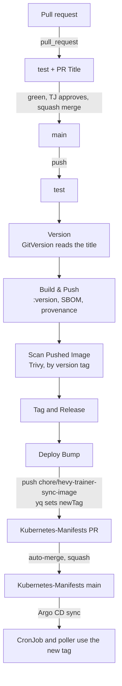

# CI/CD and Deployment Flow

How a change travels from a pull request to the CronJob in the cluster.

> **Keep this current.** A change to anything under `.github/`, to the yggdrasil release the workflows pin, to the image tag convention, or to how Kubernetes-Manifests wires the job updates this page in the same PR. Changes made in Kubernetes-Manifests that affect this flow come back here too; nothing enforces that.

## Systems

| System | Role |
|---|---|
| GitHub Actions in this repo | Tests every PR and checks its title. On main, cuts a release and opens the Kubernetes-Manifests bump |
| GitHub releases and tags | One `v<version>` tag and one immutable release per merge, with notes from the PR titles |
| Docker Hub `zimmertr/hevy-trainer-sync` | Image registry. Tags are release versions, such as `0.1.0`. Builds before 0.1.0 are tagged with their commit SHA. Tags are immutable (rule `.*`): a pushed tag can't be overwritten or deleted. Record: [0031](architectural-decision-records/0031-immutable-image-tags.md) |
| Kubernetes-Manifests `misc/hevy2garmin` | The CronJob, the poller Deployment, the PVC, and the pinned tag in `kustomization.yml`. One `images` entry sets the tag for both |
| Argo CD application `hevy2garmin` (namespace `argo-system`) | Applies Kubernetes-Manifests main to the cluster |
| Dependabot | Weekly version PRs for pip and the base image, daily ones for Actions, plus security updates. Patch and minor updates merge themselves |
| GitHub code scanning | CodeQL on every PR and push, and the weekly Trivy scan of the released image, in the Security tab |

## Conventions

- **PR title → version.** The repo merges by squash only, and the squash commit's title is the PR title. GitVersion reads that line alone. Record: [0021](architectural-decision-records/0021-semver-release-per-merge.md).

  | PR title | Bump |
  |---|---|
  | any type below with `!` before the colon: `feat!:`, `fix(poll)!:`, `chore!:` | major |
  | `feat:`, `feat(scope):` | minor |
  | `fix`, `perf`, `refactor`, `chore`, `docs`, `style`, `test`, `ci`, `build`, each with an optional `(scope)` | patch |

  The body never counts: a `BREAKING CHANGE:` footer changes nothing, so a major is always the title's `!`. A `!` anywhere else in the title is not a major. Case does not matter. Dependabot's `build(deps):` titles are patches. A title no pattern reads still releases a patch, which is why the `PR Title` check fails it. The patterns are Bluebird's, unchanged, and ship as the release module's default GitVersion rules.
- **The first version** was 0.1.0. Each merge counts from the newest tag.

## Flow



Every PR runs three workflows, and all four of their jobs are required checks:

- **test** (`test.yml`): Python 3.13, `pip install --require-hashes -r requirements-dev.txt`, the unittest suite under `coverage`, and `coverage report` across the package, in the log and in the run's summary. It has no floor; the aim is 100%. Record: [0032](architectural-decision-records/0032-coverage-aims-at-100.md).
- **PR Title / PR Title** (`pr-title.yml`): yggdrasil's `pr-title` module, which fails a title whose type isn't one of the types in the table above. It reruns when the title is edited. Record: [0038](architectural-decision-records/0038-ci-runs-on-yggdrasils-modules.md).
- **Lint** and **Docker Build / Docker Build** (`pr.yml`). `Lint` runs ruff 0.16.0 under `ruff.toml`, Bluebird's rule set. `Docker Build` is yggdrasil's `docker-build` module. It lints the `Dockerfile` with hadolint, builds the `linux/amd64` image without pushing it, and scans it with Trivy under `trivy.yaml`. It posts the table as one comment that each push rewrites (not on Dependabot's PRs, whose token can't comment). Then a smoke test runs the image: `--help` answers, psycopg loads on the image's Python, the zoneinfo data is there, and it runs as UID 1000. Last, it fails on a fixable Critical or High, as the release would. Records: [0030](architectural-decision-records/0030-pr-lint-and-image-checks.md), [0038](architectural-decision-records/0038-ci-runs-on-yggdrasils-modules.md).

A push to main runs `release.yml`, one run at a time (`concurrency: release`). It runs `test` on the squash commit, then yggdrasil's `release` module, which runs these jobs. Record: [0038](architectural-decision-records/0038-ci-runs-on-yggdrasils-modules.md).

1. **Version** runs GitVersion 6.8.2 over the full history. If that version is already tagged, everything below is skipped.
2. **Build & Push** builds `linux/amd64` and pushes `zimmertr/hevy-trainer-sync:<version>` with an SBOM and provenance, labelled with the version and the commit. Records: [0005](architectural-decision-records/0005-images-from-ci-prs-only.md), [0023](architectural-decision-records/0023-pinned-actions-and-attestations.md).
3. **Scan Pushed Image** runs Trivy against the pushed version tag with `trivy.yaml`, and fails on any fixable Critical or High. Everything below needs it. Record: [0022](architectural-decision-records/0022-scan-before-production.md).
4. **Tag and Release** tags the commit `v<version>` and makes the immutable release, with notes from the merged PR titles.
5. **Deploy Bump** checks out Kubernetes-Manifests with the `GH_PAT` secret and sets the `newTag` of the `zimmertr/hevy-trainer-sync` image in `misc/hevy2garmin/kustomization.yml` with `yq`, which keeps comments but can drop blank lines. Then it pushes `chore/hevy-trainer-sync-image` fresh off that repo's main, opens or retitles the single PR, and arms auto-merge. If the tag is already current it does nothing. Records: [0011](architectural-decision-records/0011-ci-bumps-manifests.md), [0012](architectural-decision-records/0012-tag-edited-in-place.md).
6. **Argo CD** applies the merged manifests. To skip the wait, refresh it:

   ```sh
   kubectl -n argo-system annotate application hevy2garmin argocd.argoproj.io/refresh=normal --overwrite
   ```

7. **The poller** restarts on the new image as soon as Argo CD applies it. **The next scheduled run** of the mirror uses it too. To run the mirror now:

   ```sh
   kubectl -n hevy2garmin-system create job --from=cronjob/hevy-trainer-sync hevy-trainer-sync-manual-$(date +%H%M)
   ```

Every action and yggdrasil module is pinned to a commit SHA, and the base image to tag@digest. GitVersion's version is pinned inside the release module and moves with yggdrasil.

## Branch protection

Main takes changes only through a PR, for admins too. Before the merge button works, `test`, `PR Title / PR Title`, `Lint` and `Docker Build / Docker Build` must pass and every conversation must be resolved. The branch need not be up to date with main. No approval is required, and no one can force-push or delete main. The release only pushes tags, which this does not cover. Records: [0024](architectural-decision-records/0024-branch-protection.md), [0030](architectural-decision-records/0030-pr-lint-and-image-checks.md), [0033](architectural-decision-records/0033-no-copilot-review-ruleset.md).

## Dependabot

Every Monday Dependabot checks `requirements.in` and `requirements-dev.in`, recompiling their hashed locks (holding back any release younger than seven days; record [0036](architectural-decision-records/0036-hashed-locks.md)), and the base image digest. It checks the pinned actions and yggdrasil modules daily, holding back any release younger than three days (record [0038](architectural-decision-records/0038-ci-runs-on-yggdrasils-modules.md)). It titles each PR `build(deps):` or `build(deps-dev):`, so each one releases a patch. Security updates arrive whenever GitHub publishes an advisory, without the cooldown.

`dependabot-auto-merge.yml`, yggdrasil's `auto-merge` module, arms squash auto-merge on a **patch or minor** version update and comments on the PR to say so. GitHub merges it once the required checks pass and its conversations are resolved, and the merge releases and deploys like any other. A major or a digest-only base image update waits for TJ. Dependabot reads a calendar-versioned package's year change, such as tzdata 2025.2 to 2026.6, as a major. To stop one, run `gh pr merge --disable-auto` on it, or close it. Records: [0025](architectural-decision-records/0025-dependabot-with-patch-auto-merge.md), [0037](architectural-decision-records/0037-minor-updates-merge-themselves.md), [0038](architectural-decision-records/0038-ci-runs-on-yggdrasils-modules.md).

## The weekly image scan

`image-scan.yml`, yggdrasil's `image-scan` module, scans the latest release's image every Monday at 14:17 UTC, and by hand from the Actions tab. It sends the findings to the Security tab under `trivy-released-image`, and the run fails (and GitHub emails) only on a fixable Critical or High. To fix it, merge the waiting Dependabot base-image PR if there is one. If there isn't, any merge will do: the release rebuilds with `apt-get upgrade` and no cache. CodeQL, run by GitHub's default setup, covers the code and the workflows and reports to the same tab. Records: [0026](architectural-decision-records/0026-security-scanning.md), [0038](architectural-decision-records/0038-ci-runs-on-yggdrasils-modules.md).

On 2026-11-05, before releases, the path from merge to a merged Kubernetes-Manifests PR took about three minutes.

## The release scan

A fixable Critical or High in the pushed image fails **Scan Pushed Image**. Production stays on the previous release and no GitHub release is made, but the image and the git tag stay published. The job's summary has the table. The fix is the next release: usually a rebuild is enough, because the Dockerfile runs `apt-get upgrade` after `APP_COMMIT`, which every commit changes, so merge any PR (a `chore:` will do) once Debian or PyPI has the fix. Record: [0034](architectural-decision-records/0034-upgrade-after-a-per-build-argument.md). A Python package with a fix needs its pin moved in `requirements.in`, then `make lock`.

## Finishing a failed release

Use "Re-run failed jobs" on the run's page, never "Re-run all jobs": once the image is pushed, a second Build & Push fails, because Docker Hub refuses to overwrite the version's tag. Don't re-run an old release after a newer one shipped, because its Deploy Bump would move Kubernetes-Manifests back. Merge a new PR instead, and the next release gets a new version.

## What the pipeline does not do

- **Env and secret changes.** The bump touches only the tag. A new variable or secret needs a hand-made Kubernetes-Manifests PR, merged after the release that reads it.
- **Promote between environments.** There is one environment.
- **Roll back.** Revert the commit here in a PR titled `fix: revert …` (GitHub's own `Revert "…"` title fails the PR Title check) and let the pipeline release the revert, or pin the previous version by hand in Kubernetes-Manifests.

## Secrets

| Secret | Where | Used by |
|---|---|---|
| `DOCKERHUB_USERNAME`, `DOCKERHUB_TOKEN` | This repo's Actions secrets | Build & Push |
| `GH_PAT` | This repo's Actions secrets | Deploy Bump, as the module's `deploy-token`. Needs contents and pull-requests write on Kubernetes-Manifests |
| `GITHUB_TOKEN` | Given to each run | Tag and Release, the weekly scan (SARIF upload), the auto-merge comment |
| `AUTO_MERGE_PAT` | This repo's **Dependabot** secrets | `dependabot-auto-merge.yml`. TJ's personal PAT. A merge made with `GITHUB_TOKEN` would not start `release.yml` |
